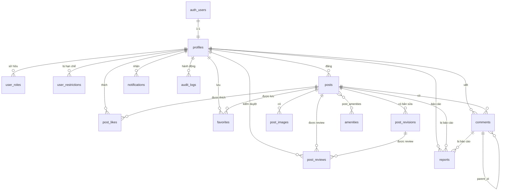

# RoomConnect — ERD & Quan hệ

## 1. ERD (Mermaid)

## 2. Bảng quan hệ

| Quan hệ | Kiểu | Ghi chú |
|---|---|---|
| `auth.users` — `profiles` | 1-1 | `profiles.id` = `auth.users.id`. Trigger tự tạo khi signup. |
| `profiles` — `user_roles` | 1-n | User có nhiều role. |
| `profiles` — `user_restrictions` | 1-n | User có nhiều hạn chế theo thời gian. |
| `profiles` — `posts` | 1-n | Author. |
| `posts` — `post_images` | 1-n | Cascade delete khi xoá cứng post. |
| `posts` — `post_revisions` | 1-n | Bản sửa đang chờ duyệt (chỉ tồn tại khi post published & bị sửa). |
| `posts` — `post_reviews` | 1-n | Lịch sử review. |
| `posts` — `post_likes` | 1-n | Unique (user_id, post_id). |
| `posts` — `favorites` | 1-n | Unique (user_id, post_id). |
| `posts` — `comments` | 1-n | |
| `posts` — `reports` | 1-n | target_type = 'post'. |
| `comments` — `comments` | 1-n (self) | `parent_id`. Nested 1 cấp. |
| `comments` — `reports` | 1-n | target_type = 'comment'. |
| `posts` — `amenities` | n-n | Bảng trung gian `post_amenities`. |

## 3. Quy tắc xoá

| FK | ON DELETE |
|---|---|
| `profiles.id` → `auth.users.id` | CASCADE |
| `user_roles.user_id` | CASCADE |
| `user_restrictions.user_id` | CASCADE |
| `posts.author_id` | RESTRICT (không xoá user khi còn bài; thực tế dùng soft delete + anonymize) |
| `post_images.post_id` | CASCADE |
| `post_revisions.post_id` | CASCADE |
| `post_reviews.post_id` | CASCADE |
| `post_likes.post_id` / `user_id` | CASCADE |
| `favorites.post_id` / `user_id` | CASCADE |
| `comments.post_id` | CASCADE |
| `comments.parent_id` | CASCADE |
| `comments.author_id` | SET NULL (giữ bình luận dù user xoá) |
| `reports.reporter_id` | SET NULL |
| `notifications.user_id` | CASCADE |
| `audit_logs.actor_id` | SET NULL (giữ log) |

## 4. Enums

| Enum | Giá trị |
|---|---|
| `app_role` | member, moderator, admin |
| `post_status` | draft, pending, published, rejected, archived |
| `availability_status` | available, rented, hidden |
| `room_type` | phong_tro, chung_cu_mini, nha_nguyen_can, o_ghep, ky_tuc_xa, khac |
| `review_action` | submitted, approved, rejected, hidden, restored |
| `restriction_type` | post_ban, login_ban, full_ban |
| `report_target` | post, comment, user |
| `report_status` | pending, reviewing, resolved, dismissed |
| `notification_type` | post_approved, post_rejected, comment, reply, like, report_result, system |
| `revision_status` | pending, approved, rejected |

## 5. Index quan trọng

| Bảng | Index | Mục đích |
|---|---|---|
| posts | `(status, published_at DESC)` WHERE deleted_at IS NULL | Trang chủ, danh sách |
| posts | `(province, ward)` | Lọc địa lý |
| posts | `(price)` | Sắp xếp giá |
| posts | `(author_id, status)` | Trang "Bài của tôi" |
| posts | `(expires_at)` | Job ẩn tin hết hạn |
| post_images | `(post_id, sort_order)` | Gallery |
| post_likes | `(post_id)` | Đếm like |
| favorites | `(user_id, created_at DESC)` | Trang yêu thích |
| comments | `(post_id, created_at)` | Load bình luận |
| comments | `(parent_id)` | Load reply |
| notifications | `(user_id, is_read, created_at DESC)` | Trang thông báo |
| reports | `(status, created_at DESC)` | Queue báo cáo |
| audit_logs | `(actor_id, created_at DESC)` | Lịch sử admin |

## 6. Ghi chú revision ảnh

**Quyết định:** Khi tin đã `published`, **không cho sửa ảnh**. Lý do:
- Đơn giản hoá schema (không cần bảng `post_revision_images`).
- Tránh phức tạp khi merge revision.
- Muốn đổi ảnh → member xoá tin cũ, tạo tin mới.

Chỉ các field văn bản (tiêu đề, mô tả, giá, diện tích, địa chỉ) mới được
tạo revision.